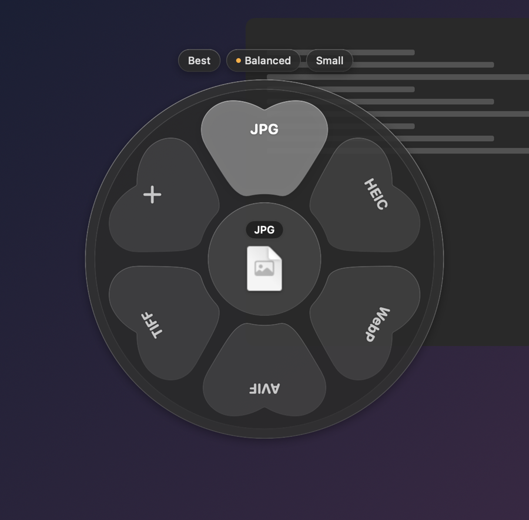
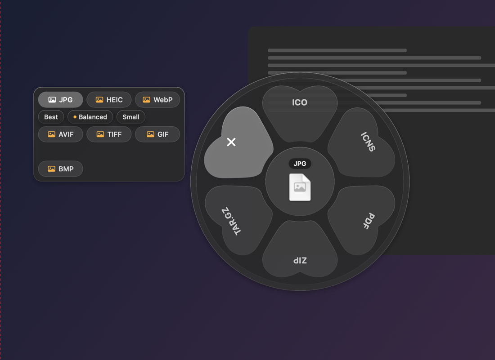
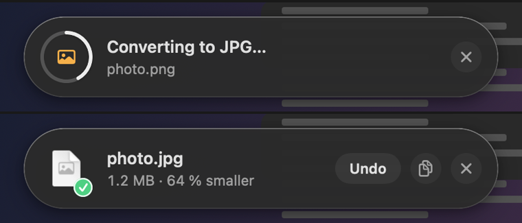
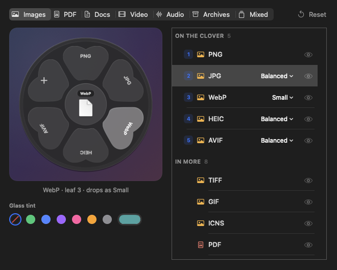
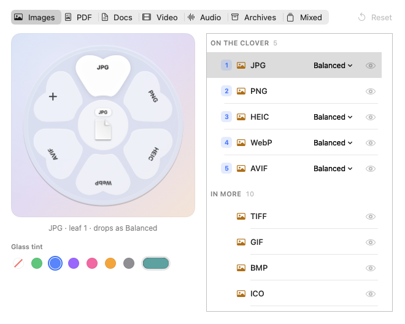

<p align="center">
  
</p>

<h1 align="center">Clover: a fast file converter for Mac</h1>

<p align="center">
  Drag a file, hold <kbd>Shift</kbd>, drop it on a leaf. Clover converts images, videos, audio, PDFs and documents right where you are, without opening an app.
</p>

<p align="center">
  
</p>

Clover is a native **macOS file converter** that lives in your menu bar. Instead of opening a converter, choosing a file and picking settings, you drag the file you already have and drop it on the format you want. Convert **HEIC to JPG**, **PNG to WebP**, **MOV to MP4**, **video to GIF**, **WAV to MP3**, **PDF to JPG**, **DOCX to PDF** and dozens more, one file or a hundred at a time.

Every conversion runs on your Mac. Clover has no accounts and no analytics, and your files never leave your computer.

## Download

<p align="center">
  <a href="https://github.com/irfanabdulhameed/clover/releases/latest/download/Clover.dmg"></a>
</p>

<p align="center">Requires macOS 14 Sonoma or later on a Mac with Apple silicon. Free and open source.</p>

**The first time you open it:**

1. Open **Clover.dmg** and drag **Clover** onto **Applications**.
2. Open Clover from Applications. Clover isn't notarized by Apple yet, so macOS says it can't check it. Click **Done** (or **OK**).
3. Open **System Settings › Privacy & Security**, scroll down to **Security**, and click **Open Anyway** next to the line about Clover. Confirm with your password or Touch ID, then click **Open**.

You only do this once. After that Clover opens like any other app and keeps itself up to date: when a new version is out, a window lists what's new and **Update Now** installs it.

## Contents

- [Download](#download)
- [Features](#features)
- [How to use Clover](#how-to-use-clover)
- [Supported formats](#supported-formats)
- [The dashboard](#the-dashboard)
- [Build from source](#build-from-source)
- [Command line](#command-line)
- [Privacy](#privacy)
- [FAQ](#faq)
- [For developers](#for-developers)
- [License](#license)

## Features

- **Convert in one gesture.** Drag any file, press <kbd>Shift</kbd>, and a clover of formats opens under your pointer. Drop on a leaf to convert.
- **Only formats that work.** The clover shows the conversions your file actually supports, in the order you choose.
- **Options without dialogs.** Rest on a leaf to pick Best, Balanced or Small for images and audio, or Original, 1080p, 720p or Small for video.
- **Batch conversion.** Drag many files at once and they convert in parallel, with one progress pill for the whole batch.
- **Merge and archive.** Merge PDFs, turn images into one PDF, make a ZIP or TAR.GZ of anything, or extract archives.
- **Safe by design.** The original is never touched. New files appear beside it with a free name ("photo 2.jpg"), and Undo moves a result to the Trash.
- **Copy the result.** One click copies the converted file, ready to paste into Finder, Mail or Slack.
- **Made for macOS.** Liquid Glass on macOS 26 Tahoe, Light and Dark mode, trackpad haptics, Reduce motion, and keyboard control throughout.
- **Motion that tells you it worked.** Choosing a leaf sends a distortion wave across the clover, bending and colouring the leaves, and a finished conversion's pill gets a beam that runs twice round its edge.
- **Keeps itself up to date.** When a new version is out, Clover shows what changed and installs it with one click.

## How to use Clover

### Open the clover

There are four ways to open it, so it fits however you work.

| Way | What to do |
|---|---|
| **Shift-drag** | Drag a file in Finder, on the Desktop or from any app, and press <kbd>Shift</kbd> while dragging. Drop the file on a leaf. |
| **Hold and Shift** | In Finder, press and hold on a file, then press <kbd>Shift</kbd>. Drag onto a leaf, or let go and click one. |
| **Shortcut** | Select files in Finder and press <kbd>⌃</kbd><kbd>⌥</kbd><kbd>Space</kbd>, then click a leaf. You can change the shortcut. |
| **Menu bar or Finder** | Drop files on the clover icon in the menu bar or its drop zone, or right-click files in Finder and choose **Services › Convert with Clover**. |

Press the same key again, or <kbd>Esc</kbd>, to close the clover without converting.

<p align="center">
  
</p>

### Choose a format

- **Drop on a leaf** to convert with that leaf's default option.
- **Rest on a leaf** and its options appear. Drop or click on an option to use it instead.
- **The + leaf** holds every other format. Rest on it and it turns into an ×, and the rest of the formats open beside the clover.
- **With the keyboard:** arrows or <kbd>Tab</kbd> move between leaves, <kbd>1</kbd> to <kbd>6</kbd> pick a leaf, <kbd>Return</kbd> converts.

<p align="center">
  
</p>

### Follow the result

A small pill shows the conversion and then the result. When it's done, a colourful beam runs twice round its edge and fades away.

<p align="center">
  
</p>

| Action | How |
|---|---|
| Show the file in Finder | Click the pill |
| Move the file somewhere | Drag the pill |
| Copy the file | The copy button, or <kbd>⌘</kbd><kbd>C</kbd> |
| Undo (move it to the Trash) | **Undo**, or <kbd>⌘</kbd><kbd>Z</kbd> |
| Cancel a running conversion | **×** |

## Supported formats

| Kind | Clover reads | Clover writes |
|---|---|---|
| **Images** | JPG, PNG, HEIC, AVIF, WebP, TIFF, GIF, BMP, PSD, camera RAW (DNG, CR2, CR3, NEF, ARW and more), ICO, ICNS, TGA, EXR, JPEG 2000, SVG | JPG, PNG, HEIC, AVIF, WebP, TIFF, GIF, BMP, ICO, ICNS, PDF |
| **PDF** | PDF | PNG or JPG for each page, TXT, a smaller PDF; several PDFs or images merged into one PDF |
| **Documents** | DOCX, DOC, RTF, RTFD, ODT, HTML, TXT, Web Archive | DOCX, RTF, HTML, TXT, PDF |
| **Video** | MP4, MOV, MKV, WebM, AVI, WMV, FLV, MPEG, MPEG-TS, 3GP, and animated GIF | MP4 (H.264 on the Mac's hardware encoder), MOV, MKV, WebM, GIF, MP3, M4A |
| **Audio** | MP3, M4A, AAC, WAV, FLAC, OGG, Opus, AIFF, WMA, CAF | MP3, M4A (AAC or Apple Lossless), WAV, FLAC, OGG, Opus, AIFF |
| **Archives** | ZIP, TAR, TAR.GZ, GZ, TAR.XZ, TAR.BZ2, 7Z, RAR | Extract to a folder; ZIP or TAR.GZ of any files and folders |

When there's no direct way, Clover chains two steps, for example HEIC → PNG → WebP or DOCX → PDF → JPG. Video and audio need [ffmpeg](https://ffmpeg.org), and WebP output needs `cwebp`: `brew install ffmpeg webp`, with [Homebrew](https://brew.sh).

## The dashboard

Open it from the menu bar icon (**Dashboard**, <kbd>⌘</kbd><kbd>,</kbd>), or open Clover again from Spotlight or Applications. While the dashboard is open, Clover shows in the Dock and in <kbd>⌘</kbd><kbd>Tab</kbd>.

<p align="center">
  
</p>

| Page | What you see or change |
|---|---|
| **Home** | A drop zone to convert files, what Clover made in the last 7 days (files, conversions, space saved), your latest conversions, and a note if an engine is missing. |
| **Clover** | Which formats sit on the clover for each kind of file, their order, which are hidden, each leaf's default option, and the glass tint. Click a leaf in the live preview to see the wave it plays. |
| **Quality** | What Best, Balanced and Small mean: image quality, video quality and size, audio bitrate, GIF width. |
| **Saving** | Where files go (beside the original or a folder), the name pattern (`{name}`, `{format}`, `{option}`), replacing or numbering, and showing results in Finder. |
| **Controls** | The key you hold while dragging, hold-to-open, and the global shortcut. |
| **General** | Motion, haptic taps and the finish sound, Open at login, updates, and whether ffmpeg and cwebp are installed. |
| **History** | Every conversion, with search, Show in Finder and Convert again. |

<p align="center">
  
</p>

## Build from source

The [download](#download) is the easy way. To build Clover yourself, you need Apple's Command Line Tools, not Xcode.

**Requirements**

- macOS 14 Sonoma or later (Liquid Glass needs macOS 26 Tahoe)
- Command Line Tools for Xcode: `xcode-select --install`
- [Homebrew](https://brew.sh), for the video, audio and WebP engines

**Steps**

```bash
# 1. Engines for video, audio and WebP
brew install ffmpeg webp

# 2. Build Clover and install it in ~/Applications
git clone https://github.com/irfanabdulhameed/clover.git
cd clover
./scripts/build.sh

# 3. Open it
open ~/Applications/Clover.app
```

The clover icon appears in the menu bar. The first time you use **Hold and Shift** or the shortcut, macOS asks to let Clover control Finder; that's how Clover reads which files are selected.

To start Clover when you log in, turn on **Open at login** in Dashboard › General. A copy you build yourself also checks for updates, and **Update Now** replaces it with the released version.

## Command line

The same converter runs without the interface, which is handy for scripts and automation:

```bash
CLOVER=/Applications/Clover.app/Contents/MacOS/Clover   # ~/Applications/… if you built it yourself

$CLOVER --version                              # the version, e.g. Clover 1.2.1 (4)
$CLOVER tools                                  # which engines are installed
$CLOVER targets holiday.heic                   # what this file can become
$CLOVER convert jpg --option small *.heic      # convert, printing the new paths
$CLOVER convert pdf-merge part1.pdf part2.pdf  # merge into one PDF
```

## Privacy

- Every conversion happens on your Mac. Your files never leave it, and Clover never sends anything about them.
- The only connections Clover makes are to GitHub, for its own updates. It asks GitHub for the list of Clover releases about 10 seconds after it starts, every 6 hours and when your Mac wakes, and only on Wi-Fi or Ethernet, never on a phone's hotspot or with Low Data Mode on. When you click **Update Now**, it downloads the new version from GitHub. Like any web request, these show GitHub your IP address and Clover's version, and nothing else.
- No analytics, accounts or tracking.
- Your originals are never changed. Conversions write new files, and Undo moves them to the Trash.
- The only permission Clover asks for is Automation for Finder, and only when you use Hold and Shift or the shortcut.

## FAQ

### How do I convert HEIC to JPG on a Mac?
Drag the HEIC photos, press <kbd>Shift</kbd> and drop them on the **JPG** leaf. The JPGs appear next to the originals. Rest on the leaf first to choose Best, Balanced or Small.

### How do I convert MOV to MP4 on a Mac?
Drag the video, press <kbd>Shift</kbd> and drop it on **MP4**. Choose **Original** to keep the size, or 1080p, 720p or Small to make it smaller. When the codecs already fit, Clover only changes the container, which takes a moment.

### Can I make a GIF from a video?
Yes. Drop a video on **GIF** and choose Large, Medium or Small.

### Can I merge PDFs or turn images into one PDF?
Yes. Drag several PDFs and drop them on **Merge**, or drag several images and drop them on **PDF**, then choose **One PDF**.

### Why don't I see WebP, video or audio formats?
Those need extra engines. Run `brew install ffmpeg webp`, then press **Refresh** in Dashboard › General.

### How do I add Clover to Finder's right-click menu?
Clover adds **Convert with Clover** under **Services**. If you don't see it, turn it on in System Settings › Keyboard › Keyboard Shortcuts › Services.

### Does Clover upload my files?
No. Every conversion happens on your Mac. The only thing Clover fetches from the internet is its own updates, from GitHub, and it sends nothing about your files.

### How does Clover update itself?
On Wi-Fi or Ethernet, Clover asks GitHub now and then whether a newer version is out. When one is, a window lists what changed in every version since yours. **Update Now** downloads it, replaces Clover (the old copy goes to the Trash) and opens the new one; **Later** asks again the next day or the next time Clover starts. After an update, macOS may ask once more to let Clover control Finder. To check yourself, right-click the menu bar icon and choose **Check for Updates…**, or use **Check for Updates** in Dashboard › General or at the bottom of the dashboard's sidebar.

### macOS says Clover can't be opened
Clover isn't notarized by Apple yet. Follow the three steps under [Download](#download): open it once, then click **Open Anyway** in System Settings › Privacy & Security. Updates installed by Clover itself don't ask again.

## For developers

```text
Sources/CloverCore   formats, routes, converters (ImageIO, PDFKit, the text system, ffmpeg, cwebp, archives), jobs
Sources/Clover       the menu bar app: the clover, the result pill, Home, the dashboard, the command line
Tests                Swift Testing suites
scripts              build.sh, test.sh, make-dmg.sh, release.sh, make-icon.sh, check-builtin.sh, check-media.sh
```

```bash
./scripts/test.sh                 # unit tests
./scripts/check-builtin.sh        # every built-in conversion on generated sample files
./scripts/check-media.sh          # every video and audio conversion
.build/debug/Clover --bloom-selftest   # the clover's layout and motion checks
./scripts/make-dmg.sh             # build/Clover.dmg, the download
```

### Making a release

Releases are built on a Mac and published with [gh](https://cli.github.com):

```bash
./scripts/release.sh patch --dry-run   # everything except pushing and publishing
./scripts/release.sh patch             # or minor, major; --notes notes.md for your own notes
```

The script checks that `main` is clean and pushed, sets the version in `Resources/Info.plist`, commits "Release X.Y.Z", builds `Clover.dmg`, tags `vX.Y.Z`, pushes, and creates the GitHub release with `Clover.dmg` attached. The notes are the commits since the last release that touch the app. The disk image always has the same name, so the download link above always gets the newest one, and running copies of Clover find it within hours.

To try the updater without a release, point a copy at a local feed: `Clover.app/Contents/MacOS/Clover --update-check -updateFeedURL http://127.0.0.1:8000/releases.json` prints what the update window would list (add `--accept` to install). `--render-update <folder>` draws every state of the window.

## License

Clover is free and open source under the [MIT License](LICENSE). © 2026 Irfan Abdul Hameed.

The distortion wave and the border beam are ported from Jakub Antalik's [Distortion Waves and Border Beam](https://github.com/Jakubantalik/Libraries.dev) ([libraries.dev](https://libraries.dev)), MIT License, © 2026 Jakub Antalik. Their notices are kept in the files that carry their code.
